# VCaaS System Design

## 1. Scope and goals

VCaaS is a voice-cloning and audio-authenticity platform with four primary workflows:

1. Authenticate a creator and manage voices.
2. Generate speech from a reference voice or trained voice model.
3. Embed and verify provenance watermarks and run forensic analysis.
4. Define voice licenses, issue tokens, and meter usage.

The design prioritizes:

- Explicit consent and traceable ownership for voice assets.
- Durable, replayable audio jobs instead of process-local state.
- Isolation of CPU/GPU model inference from the HTTP API.
- Auditable licensing, watermark, and usage decisions.
- A gradual path from the current prototype to production without changing the public API unnecessarily.

## 2. Current repository architecture

The current application is split into:

- **Frontend:** Next.js App Router in `frontend/`, deployed independently to Vercel.
- **API:** FastAPI in `backend/app/main.py`, exposed under `/api/v1`.
- **Persistence:** SQLAlchemy models with SQLite or PostgreSQL configuration.
- **Cache and jobs:** Redis and Celery are present in the development composition, but the primary TTS service currently keeps jobs in memory and starts work with `asyncio.create_task`. Durable queued jobs are the target architecture, not the current implementation.
- **Audio services:** XTTS zero-shot, voice processing, watermarking, forensic analysis, speaker verification, and streaming verification services.
- **Storage:** Local filesystem paths are used by several services; object storage should be the production boundary for uploaded and generated audio.
- **Authentication:** JWT-style backend authentication with Firebase/OTP integration in the frontend and API.
- **Live demo:** `/live-demo` captures browser microphone audio through an AudioWorklet, resamples it to 16 kHz mono PCM, and streams it to `/api/v1/verify/stream` over WebSocket.

The canonical HTTP entry point should remain `backend/app/main.py`. The alternate `backend/main.py` and legacy scripts should be treated as migration/development artifacts and removed or clearly isolated.

### Current versus target behavior

The diagrams in this document describe the target production architecture unless a section is explicitly marked **Current implementation**. The current repository is a working prototype with some production-oriented interfaces already present:

| Area | Current implementation | Target implementation |
|---|---|---|
| Browser live verification | Browser AudioWorklet -> WebSocket -> per-connection `StreamSession` | Same protocol with stronger session limits, telemetry, and deployment controls |
| TTS jobs | Process-local in-memory job map and `asyncio.create_task` | PostgreSQL job state plus Redis/Celery or managed queue workers |
| Audio files | Local filesystem paths in several services | Object storage with signed URLs and lifecycle policies |
| Real-time call verification | Browser/SDK streaming demo; no carrier integration yet | Telephony-operator/network media integration with carrier-edge detection and explicit coverage state |
| Verification | Fast layers run in the stream; semantic and watermark checks run asynchronously when thresholds are reached | Versioned, isolated analysis workers with durable reports and evidence retention |

## 3. Target logical architecture

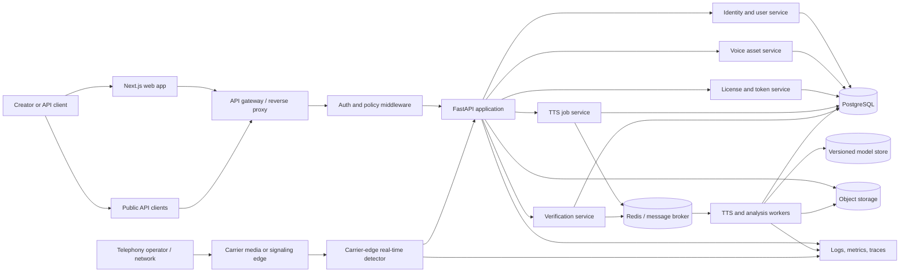

### Component responsibilities

| Component | Responsibility | Scaling boundary |
|---|---|---|
| Next.js frontend | User workflows, upload UX, job polling, dashboards | Vercel/edge or static deployment |
| API gateway | TLS, request IDs, body limits, rate limiting, routing | Horizontally scaled |
| FastAPI API | Authentication, authorization, validation, orchestration, synchronous metadata APIs | Horizontally scaled, stateless |
| PostgreSQL | Users, voices, jobs, licenses, tokens, usage, verification records | Primary database with backups |
| Object storage | Reference audio, generated audio, reports, model artifacts | Durable blob storage with lifecycle rules |
| Redis | Cache, rate limits, short-lived locks, broker transport | Managed Redis; no business data as source of truth |
| TTS workers | XTTS inference, watermarking, encoding | CPU/GPU pools, separately autoscaled |
| Analysis workers | Forensics, anti-spoofing, speaker match, semantic analysis | CPU/GPU pools, separately autoscaled |
| Carrier media adapter | Receives operator-approved media or derived features and normalizes codecs/session metadata | Deployed at operator or carrier edge |
| Edge detector | Runs VAD, windowing, low-latency model inference, and risk-event emission without depending on recipient internet | Regionally deployed near media ingress |
| Policy and control plane | Applies consent, jurisdiction, thresholds, intervention rules, and operator permissions | Highly available control service |
| Alert/intervention service | Delivers permitted warnings, labels, agent events, or call-control requests | Operator-integrated, policy controlled |
| Observability | Structured logs, metrics, traces, audit events | Centralized platform |

## 4. Core data model

The following entities should be durable and versioned:

- **User:** identity, roles, subscription state, consent status, timestamps.
- **Voice:** owner, display name, lifecycle status, consent evidence, model version, storage references.
- **VoiceSample:** object key, checksum, duration, format, quality checks, ownership link.
- **ModelVersion:** model type, artifact URI, framework/runtime version, checksum, supported languages, status.
- **TTSJob:** requester, voice, input parameters, status, progress, idempotency key, output object key, error code, timestamps.
- **AnalysisJob:** input object, requested analysis depth, status, per-layer results, aggregate score, timestamps.
- **WatermarkRecord:** generated artifact, watermark ID, signing key version, embedding metadata, verification status.
- **License:** owner, voice, type, terms, expiry, usage limit, active status.
- **LicenseToken:** hashed token, license, purchaser metadata, expiry, revocation state, last-used time.
- **UsageEvent:** immutable event for characters, seconds, API calls, analysis jobs, and license consumption.
- **AuditEvent:** actor, action, resource, request ID, outcome, and timestamp.
- **OperatorPolicy:** operator, jurisdiction, consent mode, retention, allowed actions, thresholds, and policy version.
- **RiskEvent:** call/session ID, time window, layer scores, fused score, confidence, coverage, model versions, and action taken.
- **IncidentCase:** escalated risk event, operator decision, intervention status, analyst notes, and outcome.
- **ModelEvaluation:** dataset version, model version, accuracy, latency, bias/robustness metrics, approval state, and rollback target.

Store hashes of API/license tokens, never the raw token after issuance. Store audio checksums and immutable object versions so a verification result can be reproduced.

## 5. Main request flows

### 5.1 Voice upload and registration

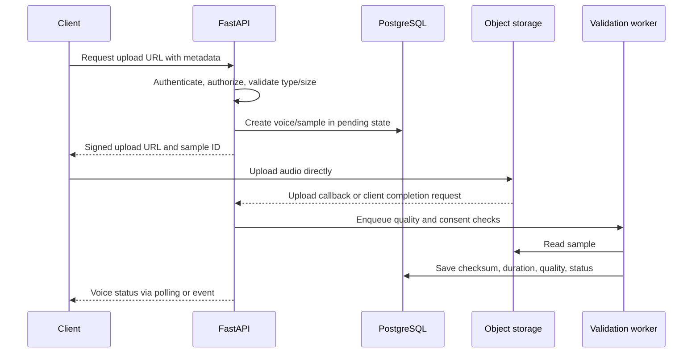

The API should not proxy large audio bodies in production unless required for a controlled verification path. Signed URLs reduce API memory pressure and make retries safer.

### 5.2 TTS generation

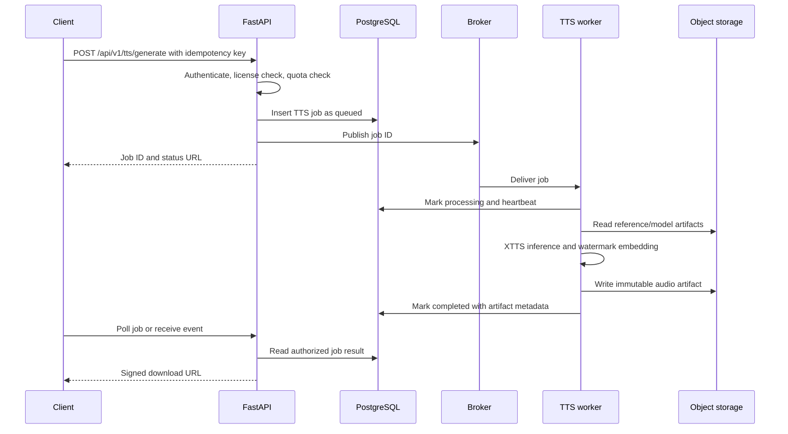

A worker must claim jobs with a lease and be able to retry safely. Completion should be idempotent: the same job cannot charge usage twice or create multiple authoritative outputs.

### 5.3 Verification and forensic analysis

Verification should return a structured result with independent layer outputs:

1. Validate content type, size, duration, and checksum.
2. Detect cryptographic watermark.
3. Run acoustic anti-spoofing and spectral analysis.
4. Run speaker comparison only when a reference is authorized and present.
5. Run prosody, paralinguistic, and semantic analysis according to analysis depth.
6. Persist the raw layer results and a versioned aggregate decision.
7. Return a report ID and downloadable report/artifact links.

The aggregate result must include model/service versions and confidence limitations. A watermark detection result is strong provenance evidence, but should not be described as proof of general authenticity without the other layers.

#### Real-time verification loop

The streaming verification workflow uses `ws://host/api/v1/verify/stream`. The client sends binary mono PCM frames, normally 16-bit signed audio at 16 kHz. The server keeps a per-connection session with a circular buffer and returns JSON verdicts for speech-containing windows. Silence and short buffers do not produce a verdict.

#### Current browser live-demo workflow

The repository currently demonstrates real-time detection through a browser microphone. This is useful for proving the detection engine and WebSocket path, but it is not a phone-call implementation.

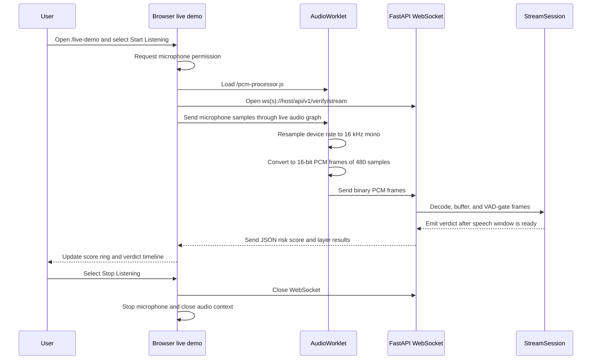

The browser audio graph uses a zero-gain sink. It is silent to the user but keeps the AudioWorklet connected and processing; leaving the worklet disconnected can cause browsers to suspend processing. The worklet also preserves partial resampling buffers so device rates such as 44.1 kHz or 48 kHz still produce valid 16 kHz frames.

**Browser demo states:**

```text
idle -> connecting -> open -> receiving verdicts -> closed
    |         |             |                         |
    +---------+-------------+---- recoverable error --+
```

- `idle`: no microphone or WebSocket resources are active.
- `connecting`: permission, AudioWorklet, and WebSocket setup are in progress.
- `open`: the WebSocket is connected and PCM frames can be sent.
- `receiving verdicts`: the backend has received enough speech for analysis and the UI updates continuously.
- `closed`: the user stopped, the server disconnected, or an error occurred; all resources must be released.

If no verdict appears, debug in this order: microphone permission, `AudioContext.state`, AudioWorklet loading, WebSocket open state, outgoing binary frames, backend VAD, and finally model-layer errors. Silence or less than one second of speech intentionally produces no result.

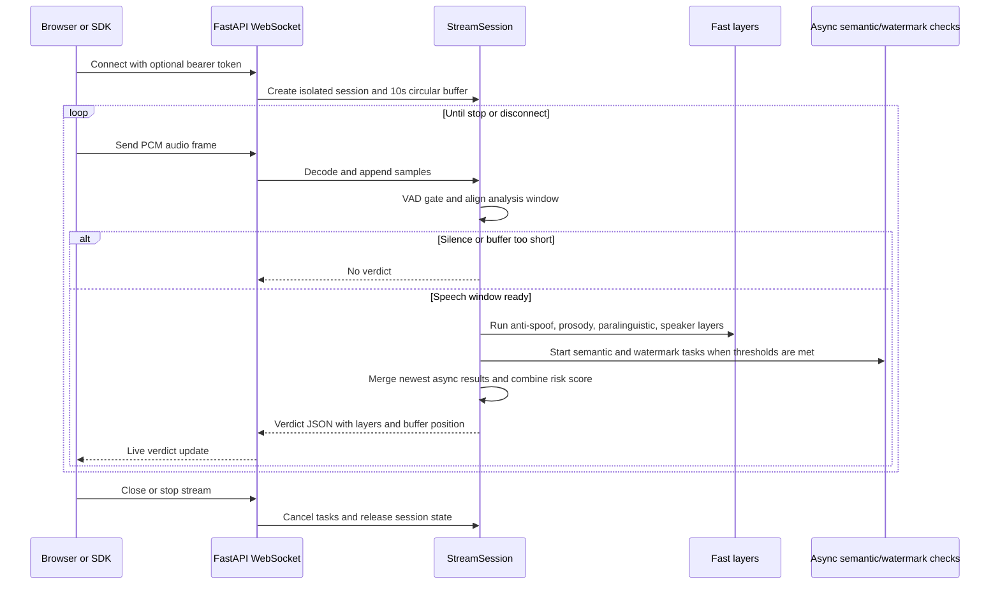

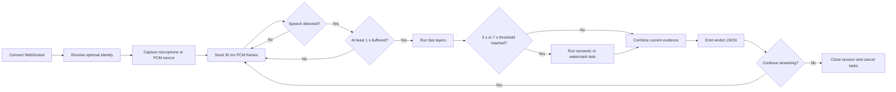

The client should treat each verdict as a time-local observation, not a final file verdict. It should display the current score, confidence, buffer duration, and layer availability, then allow the user to stop, save the session, or switch to full-file verification. The backend should enforce frame-size and payload limits, bound the number of concurrent sessions, and avoid putting raw audio in logs.

#### Carrier real-time detection and intervention workflow

This is the production workflow for operator-integrated calls. The six detection layers run as independent signals after VAD and windowing. The risk engine combines them instead of allowing one failed or unavailable layer to decide the call by itself.

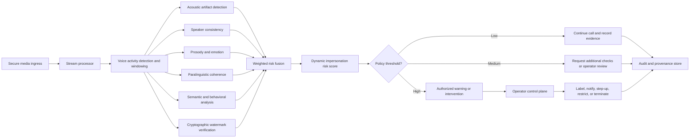

The call must not be terminated solely because a single detector fails. Missing layers reduce coverage and confidence; a high-risk action requires the configured policy, evidence, and operator authorization.

#### Risk response workflow

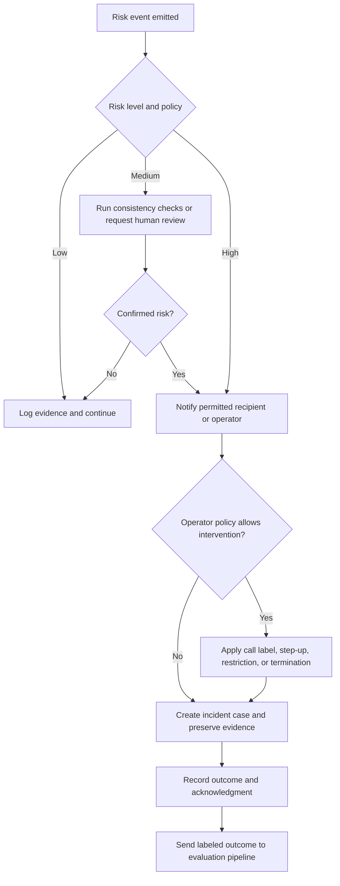

The control plane must separate **detection** from **intervention**. The detector produces evidence and a risk score; policy decides what action, if any, the operator is allowed to take.

#### Telephony-operator and network call verification architecture

The production real-time product is integrated into a telephony operator, carrier, CPaaS, SIP, or trusted network media path. It is not a mobile application that records cellular calls. The network integration receives the permitted call media or an operator-provided media fork before analysis, so verification does not depend on the end user's internet connection.

Android and iOS restrictions are handled by keeping call-audio access outside the handset application. The mobile device may receive a warning, call label, or post-call notification, but it is not the source of the audio and is not responsible for continuous streaming.

The integration must be agreed with the operator and governed by lawful-intercept, consent, recording, privacy, data-residency, and retention requirements. The exact media handoff may be RTP/SRTP, SIPREC, a CPaaS media stream, a carrier SBC fork, or another operator-approved interface.

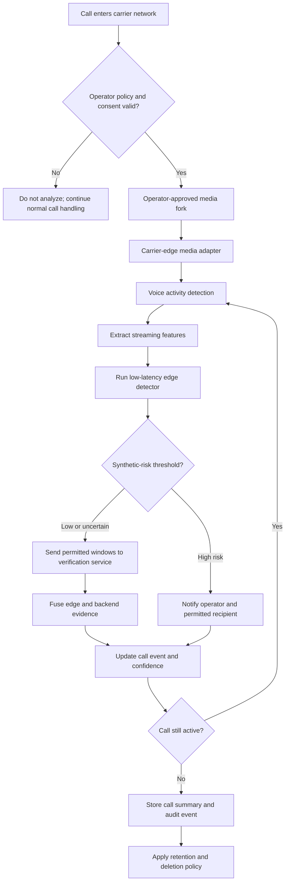

#### Mobile real-time verification loop

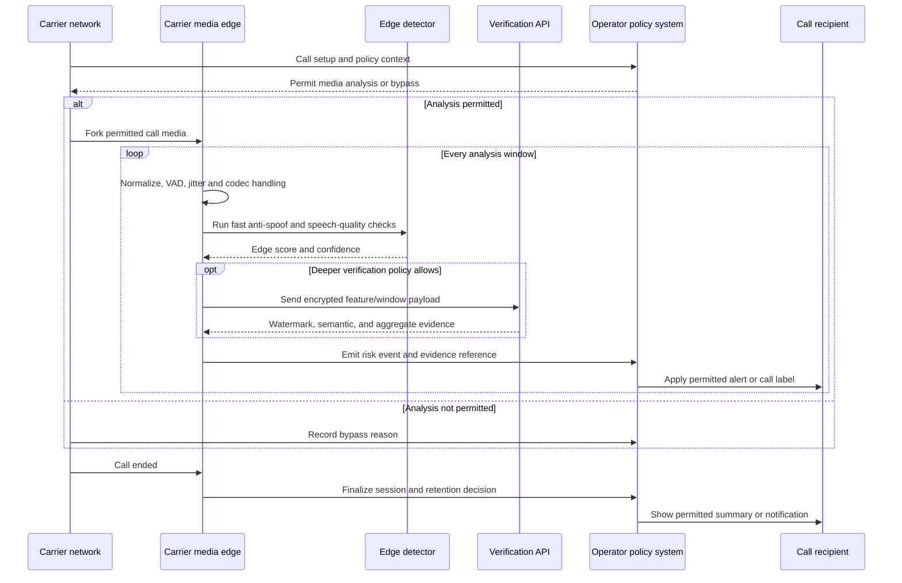

#### Carrier integration responsibilities

- Establish the operator-approved media handoff, codec contract, session identity, and regional routing.
- Enforce consent, recording notices, lawful-intercept requirements, data residency, and retention policy at the network boundary.
- Keep the low-latency detector at the carrier edge so calls continue to be analyzed when the recipient has no internet connection.
- Send only permitted features or short windows to the central verification service; encrypt media-derived data in transit.
- Attach call/session IDs, model versions, coverage, and confidence to every risk event.
- Define how alerts reach the operator, recipient, call-center agent, or downstream fraud system.
- Finalize and delete temporary media according to the operator retention contract.

The backend WebSocket remains useful for the browser demo, SDK clients, and selected VoIP integrations. It is not the production carrier media interface. The carrier media adapter and edge detector are the production real-time boundary; the central backend provides policy, deeper analysis, evidence, reporting, and model management.

### 5.4 Licensing and usage

License creation is synchronous metadata work. Token issuance creates a random bearer token, stores only its hash, and returns the raw token once. Every protected generation request resolves the token to a license, checks expiry/revocation/territory/use case/quota, then writes an immutable usage event in the same transaction boundary as the job reservation.

Usage counters may be cached in Redis for speed, but PostgreSQL usage events remain the accounting source of truth. A periodic reconciler repairs counters from events.

### 5.5 Purpose-based looping workflows

The application should behave as a set of closed user loops. Every loop starts at an authenticated workspace, performs one purpose-specific action, shows an inspectable result, and returns the user to the workspace with the next useful action. A failed or incomplete step returns to the nearest safe retry point rather than losing the upload or job context.

#### End-to-end application loop

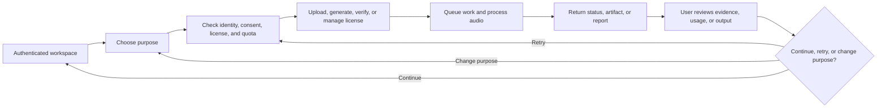

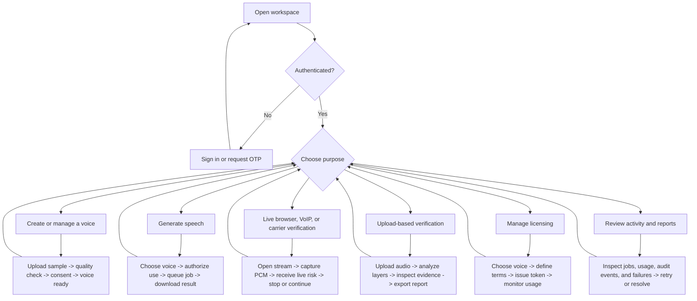

#### Voice creation and generation loop

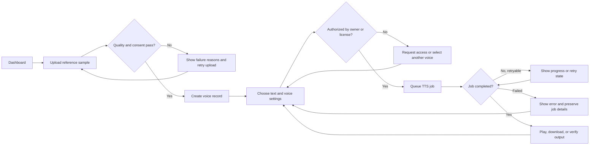

#### Audio verification loop

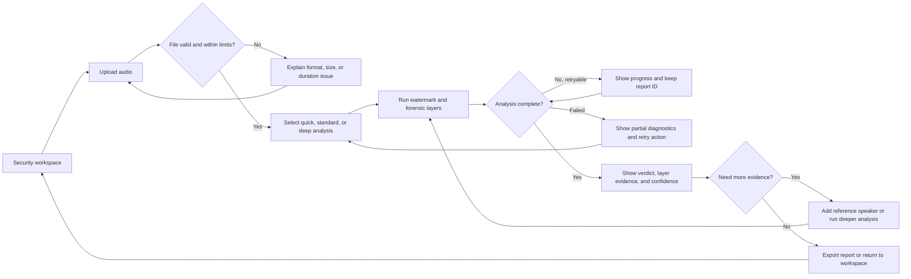

#### Licensing loop

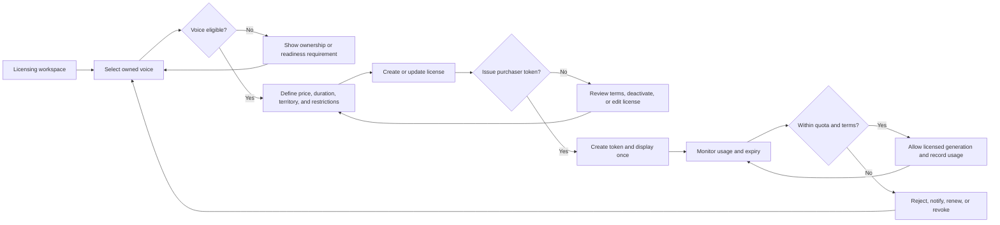

#### Operations and review loop

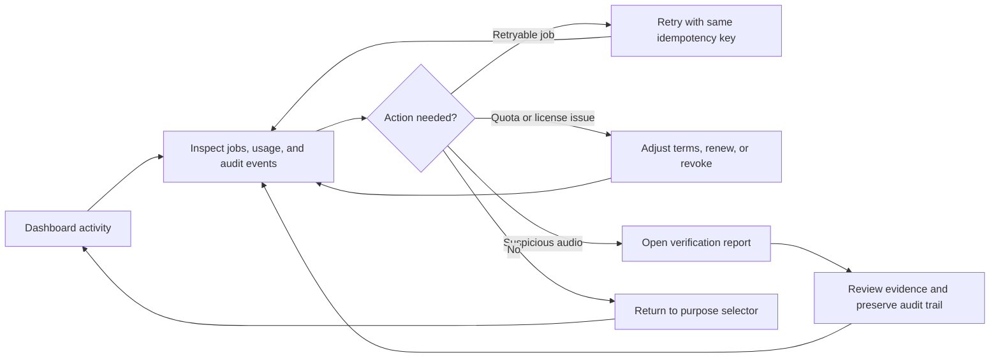

The frontend should persist the active purpose, job ID, upload metadata, and report ID in the URL or recoverable client state. The backend remains authoritative; client state only restores the user experience after refresh.

### 5.6 Workflow explanation guide

This section explains the diagrams for readers who are not familiar with the system. Each workflow follows the same pattern:

```text
Choose a purpose -> check permission -> perform the action -> process the request
-> show the result -> let the user continue, retry, or choose another purpose
```

The loop is intentional. The application is not designed as a one-time form submission. Users repeatedly move between creating voices, generating audio, verifying audio, managing licenses, and reviewing activity.

#### The complete application loop

1. **Workspace:** The user opens the dashboard, operator console, or client integration.
2. **Purpose:** The user chooses what they want to do: create, generate, verify, license, or review.
3. **Authorization:** The system checks identity, ownership, consent, license terms, quota, operator policy, and jurisdiction.
4. **Execution:** The user uploads audio, starts generation, starts verification, or changes a license.
5. **Processing:** Fast work runs immediately; expensive audio work is sent to a queue and worker.
6. **Result:** The application returns a status, audio artifact, verification report, warning, or license state.
7. **Inspection:** The user reviews the result, evidence, usage, and confidence.
8. **Next action:** The user continues, retries from the nearest safe step, or changes purpose.

For a non-technical reader:

> The user chooses a task, the system checks whether it is allowed, performs it, explains the result, and brings the user back to the application for the next task.

For an engineer:

> The client drives a state machine. The API authorizes and persists state, workers process long-running jobs, and every terminal or recoverable state exposes a deterministic next transition.

#### Voice creation and speech generation

**Purpose:** Create an owned voice and use it to generate speech.

**User explanation:**

> The user uploads a voice sample. The system checks whether the audio is usable and whether the user is allowed to use it. Once the voice is ready, the user enters text, selects settings, and requests speech. The generated file is watermarked and can be played, downloaded, or sent to verification.

**Technical sequence:**

1. The client requests an upload URL or submits a controlled upload.
2. The API creates a pending voice and sample record.
3. Object storage receives the audio.
4. A validation worker checks format, duration, quality, checksum, and consent metadata.
5. The voice becomes ready, rejected, or requires user action.
6. The API checks voice ownership or a valid license before generation.
7. The API creates a durable `TTSJob` and publishes its ID to the broker.
8. A TTS worker loads the correct model version, synthesizes audio, embeds the watermark, and stores the output.
9. The API reports progress and returns a signed download URL after completion.

**Failure and retry behavior:**

- Invalid audio returns the user to upload with a specific reason.
- Missing consent returns the user to the consent step.
- Unauthorized use returns the user to license selection or access request.
- A temporary worker failure retries the same job using its idempotency key.
- A permanent failure preserves the job and error code so the user can retry or report it.

**Components involved:** frontend or mobile client, FastAPI, PostgreSQL, object storage, Redis, validation worker, TTS worker, watermark service, and model store.

#### Audio verification and forensic analysis

**Purpose:** Determine whether an audio file contains evidence of synthetic generation or manipulation.

**User explanation:**

> The user uploads or selects audio and chooses how deeply it should be checked. The system runs several independent tests, displays the evidence behind the result, and allows the user to perform deeper analysis or export a report.

**Technical sequence:**

1. Validate file type, size, duration, checksum, and decoding.
2. Detect the VCaaS watermark.
3. Run acoustic anti-spoofing and spectral checks.
4. Compare the speaker when an authorized reference voice is supplied.
5. Analyze prosody, paralinguistic patterns, and semantic timing as requested.
6. Combine available layer results using a versioned risk-scoring policy.
7. Persist the raw layer outputs, model versions, confidence, and final decision.
8. Return a report ID and evidence to the client.

**Important interpretation:**

The result is evidence, not an absolute claim about reality. A detected watermark is strong evidence that a known system generated or processed the file. An absent watermark does not prove that the speaker is human. The interface must show confidence, unavailable layers, and observed coverage.

**Failure and retry behavior:**

- Unsupported or damaged files return to upload.
- A failed analysis preserves the report/job ID and allows retry.
- A partial result identifies which layers succeeded and which failed.
- A user can add a reference speaker or choose a deeper analysis level.

#### Real-time carrier call verification

**Purpose:** Detect synthetic or manipulated speech during a carrier-handled call and deliver an authorized risk event without depending on the recipient's internet connection.

**User explanation:**

> When a call enters the operator's network, the operator-approved integration sends permitted media or derived features to a carrier-edge detector. The detector produces a low-latency risk signal during the call, while the central backend can perform deeper analysis and store an audit summary. The recipient's phone does not need to record or stream the call.

**Technical sequence:**

1. The carrier network receives call setup and policy context.
2. The operator policy system checks consent, jurisdiction, subscription, and analysis eligibility.
3. An approved media adapter receives a media fork or permitted derived features.
4. The carrier edge normalizes codecs, performs VAD, and extracts short analysis windows.
5. An edge model produces the first low-latency risk signal.
6. Permitted features or windows are sent over an encrypted private path to the central backend when deeper analysis is needed.
7. The backend runs watermark, semantic, and forensic checks and returns evidence.
8. The operator applies an authorized alert, call label, agent notification, or downstream fraud action.
9. At call end, the operator finalizes the session, records an audit event, and applies retention rules.

**Platform and network boundary:**

Android and iOS restrictions are the reason call audio is not captured by a handset application. The operator or telephony provider must supply the approved media integration. The product depends on carrier/CPaaS/SIP capabilities, regional law, consent, and the operator's ability to fork or expose call media.

The system must never claim to verify audio that the operator integration could not observe. Every result must include coverage state, media source, policy decision, model version, and confidence.

**Failure and retry behavior:**

- If operator policy denies analysis, bypass media processing and record the reason.
- If the central internet path fails, continue edge detection and queue only permitted event metadata for later synchronization.
- If the edge model is unavailable, mark live detection unavailable instead of inventing a verdict; the call itself must not be interrupted by the detector.
- If backend analysis fails, keep the edge result and mark remote evidence as unavailable.
- If the call ends, stop processing and apply operator retention and deletion rules.

#### Licensing and usage

**Purpose:** Let a voice owner define how another person or system may use a voice.

**User explanation:**

> The owner selects a voice, defines the terms, and creates a license. A purchaser receives a token that represents that license. Every generation request checks the token, expiry, restrictions, and remaining quota before allowing use.

**Technical sequence:**

1. Verify that the user owns or administers the voice.
2. Store license terms such as price, duration, territory, use case, restrictions, and quota.
3. Generate a random license token.
4. Return the raw token once and store only its hash.
5. On every protected request, resolve the token hash.
6. Check license status, expiry, territory, use case, and quota.
7. Reserve usage atomically with job creation.
8. Record an immutable usage event.
9. Allow renewal, restriction, deactivation, or revocation.

**Failure and retry behavior:**

- A user without ownership cannot create a license for the voice.
- An expired or revoked token is rejected.
- A quota violation is rejected before audio generation starts.
- A lost token cannot be recovered from the database; a new token must be issued.
- Counter discrepancies are repaired from immutable usage events.

#### Operations and review

**Purpose:** Help users and operators understand what happened and recover from problems.

**User explanation:**

> The dashboard is the control room. It shows jobs, usage, licenses, reports, warnings, and failures. The user can retry safe failures, change license terms, investigate suspicious audio, or return to a new task.

**Technical responsibilities:**

- Display durable job and report state.
- Correlate user actions with request IDs, job IDs, and audit events.
- Separate retryable failures from permanent failures.
- Prevent duplicate billing or duplicate job completion through idempotency.
- Preserve evidence and model versions for later review.

#### What each system layer does

| Layer | Simple explanation | Engineering responsibility |
|---|---|---|
| Web/operator/client integration | The place where a user or operator chooses and observes work | UI state, uploads, polling, live events, recovery actions |
| API gateway | The controlled entrance | TLS, limits, routing, request IDs, rate limiting |
| FastAPI | The coordinator | Authentication, authorization, validation, job creation, result access |
| PostgreSQL | The permanent notebook | Users, voices, jobs, licenses, usage, reports, audit records |
| Object storage | The file warehouse | Audio, reports, model artifacts, checksums, lifecycle policies |
| Redis/broker | The task mailbox | Queue transport, locks, cache, rate-limit support |
| Workers | The specialist teams | TTS, watermarking, forensics, speaker matching, semantic analysis |
| Model store | The versioned tool cabinet | Approved model artifacts and runtime metadata |
| Observability | The system flight recorder | Logs, metrics, traces, alerts, and operational evidence |

#### How to explain the architecture to different audiences

**For a non-technical stakeholder:**

> Users or operators choose a task. The platform checks permission and consent, processes the audio at the appropriate network boundary, explains the result, and lets them continue or retry. The carrier edge handles immediate call detection, while the backend provides deeper analysis and keeps the records.

**For a backend engineer:**

> FastAPI is stateless orchestration. PostgreSQL is the source of truth, object storage holds blobs, Redis transports jobs, and workers perform inference. Jobs require leases, retries, idempotency, durable state transitions, and atomic usage accounting.

**For a telecom/network engineer:**

> The operator integration owns call lifecycle events, media forking, codec normalization, policy enforcement, edge inference, private connectivity to the backend, and alert delivery. The handset is a notification surface, not the call-audio capture point.

**For an ML engineer:**

> Real-time analysis uses VAD-gated sliding windows. Fast models run locally for low latency; heavier semantic, watermark, and forensic models run remotely when allowed. Every score needs model version, confidence, coverage, and layer availability.

**For a security engineer:**

> Consent, ownership, license tokens, signed URLs, data retention, encryption, audit events, rate limits, and key rotation are authorization and trust boundaries, not optional add-ons.

**For a product manager:**

> The product is a set of repeatable loops: create a voice, generate speech, verify audio, license a voice, or review activity. Each loop has a success state, a failure state, and a clear next action.

## 6. API boundaries

Keep the existing versioned prefix and make contracts explicit:

- `/api/v1/auth/*`: registration, login, OTP, profile, API credentials.
- `/api/v1/voices/*`: upload, quality status, ownership, model metadata.
- `/api/v1/tts/*`: synchronous synthesis where safe, queued generation, job status, download.
- `/api/v1/licenses/*`: license lifecycle, token issuance, usage and revocation.
- `/api/v1/verify/*`: watermark, forensic, speaker match, anti-spoof, streaming sessions.
- `/api/v1/operator/*`: operator onboarding, media-session authorization, policy configuration, risk-event delivery, intervention requests, and outcome acknowledgments.
- `/health/live`: process is running.
- `/health/ready`: database, broker, object storage, and required model dependencies are available.

Every request should carry or receive a request ID. Error responses should use a stable shape with `code`, `message`, `request_id`, and optional field errors. Do not expose exception strings when `DEBUG` is false.

## 7. Security and trust model

- Default production configuration must fail closed: `DEBUG=false`, strong secret keys required, docs disabled or protected, and no mock authentication token.
- Enforce ownership checks for every voice, job, license, token, report, and download URL.
- Apply upload limits before reading the entire body; inspect both MIME type and decoded audio format.
- Scan uploads and keep them outside the application filesystem namespace.
- Use short-lived signed object URLs for downloads.
- Encrypt storage and database backups; rotate watermark signing keys by version.
- Rate-limit authentication, uploads, generation, and verification independently.
- Add audit events for consent changes, license changes, token issuance/revocation, downloads, and administrative actions.
- Treat model files and generated audio as untrusted data at process boundaries.

## 8. Reliability and observability

Required metrics:

- API request count, latency, error rate, and rate-limit outcomes.
- Queue depth, job age, retries, lease expirations, and dead-letter count.
- TTS inference latency, model load time, GPU/CPU utilization, and output failures.
- Verification layer latency and disagreement rates.
- Storage upload/download failures and artifact checksum mismatches.
- License quota consumption and rejected requests.

Use structured JSON logs with request ID, user ID, job ID, voice ID, and service version where available. Never log raw audio, bearer tokens, passwords, or private keys.

## 9. Governance and continuous-improvement workflows

The new workflows add a lifecycle around the runtime system. Production deployment is governed rather than treated as a one-time model launch.

### 9.1 Operator delivery lifecycle

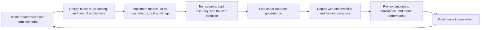

Each gate must produce evidence before the next stage: threat and harm scenarios, architecture decisions, test results, operator approval, deployment runbooks, incident procedures, and post-pilot findings.

### 9.2 Model and threshold feedback loop

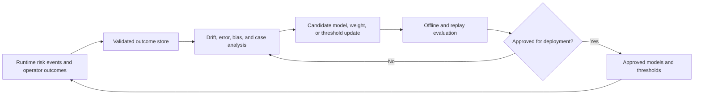

Only approved model and threshold versions may reach the carrier edge. Every risk event must identify the versions used so a false positive, false negative, or intervention can be replayed and investigated. Operator outcomes are labeled feedback, not automatic truth; they require quality and governance review before training or threshold changes.

### 9.3 Feasibility and risk controls

| Risk or open challenge | Required control |
|---|---|
| Live compressed or noisy call audio lowers accuracy | Calibrate thresholds on operator media, track codec and signal quality, and expose coverage/confidence |
| Streaming ASR is expensive and latency-sensitive | Use VAD-gated windows, asynchronous semantic checks, and edge-first fast layers |
| New voice-cloning models create unseen attacks | Maintain replay datasets, red-team with unseen generators, and require model approval |
| Regional languages and accents are underrepresented | Collect consented regional data and report per-segment performance before rollout |
| Operator integration is commercially or technically unavailable | Build a sandbox media adapter and keep browser/SDK streaming as a demonstration path, not as a substitute for carrier production |
| An incorrect detector could disrupt calls | Separate detection from intervention, require policy authorization, and define fail-open/fail-safe behavior per operator |

## 10. Deployment topology

### Development

Use Docker Compose with PostgreSQL, Redis, API, frontend, and optional worker services. Keep model downloads and generated audio in named volumes. The development composition should reference only files that exist and should use explicit health checks.

### Production

- Vercel serves the Next.js frontend.
- A managed ingress routes API traffic to stateless FastAPI instances.
- Managed PostgreSQL stores transactional data.
- Managed Redis provides broker/cache functions.
- S3-compatible object storage holds audio, reports, and model artifacts.
- Dedicated CPU/GPU worker pools process TTS and analysis jobs.
- A dead-letter queue captures permanently failed jobs.
- Centralized monitoring receives metrics, traces, logs, and alerts.

Do not run GPU inference inside Vercel functions or inside the API web process. Do not use local disk or in-memory dictionaries as durable state.

## 11. Recommended implementation phases

### Phase 1: Stabilize the current application

- Keep `backend/app/main.py` as the only supported API entry point.
- Remove or quarantine alternate entry points and stale integration tests.
- Fix Python/SQLAlchemy version pinning and make `/health/live` and `/health/ready` explicit.
- Make production secrets mandatory and disable mock auth outside tests.
- Keep frontend CI strict: type-check, lint, and production build.

### Phase 2: Make audio jobs durable

- Add database-backed `TTSJob` and `AnalysisJob` records.
- Replace `asyncio.create_task` with Celery/RQ/managed queue dispatch.
- Add job leases, retries, cancellation, idempotency keys, and dead-letter handling.
- Move audio artifacts to object storage and return signed URLs.

### Phase 3: Harden trust and accounting

- Add consent records and immutable audit events.
- Hash license tokens and implement atomic quota reservation.
- Version watermark keys, forensic algorithms, and model artifacts.
- Add reconciliation for usage events and billing exports.

### Phase 4: Scale model execution

- Split TTS and analysis workers into independently scalable pools.
- Add model warmup, resource-aware routing, and model cache management.
- Add load tests for concurrent generation, uploads, verification, and worker recovery.

## 12. Architecture decisions

- **PostgreSQL is the system of record.** Redis accelerates work but does not define ownership, billing, or job history.
- **Object storage is the system of record for audio.** Local files are development-only.
- **Asynchronous processing is mandatory for model inference.** HTTP endpoints create and observe jobs; workers execute them.
- **The API remains stateless.** Any instance can serve any authenticated request.
- **Verification is evidence-producing, not just verdict-producing.** Preserve layer results, versions, and limitations for later review.
- **Licensing is an authorization boundary.** A valid login alone does not authorize use of a voice or model.
